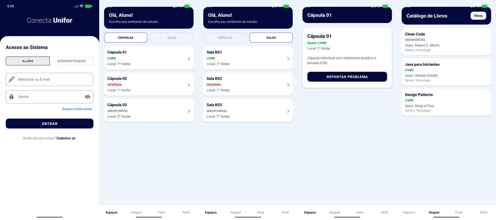
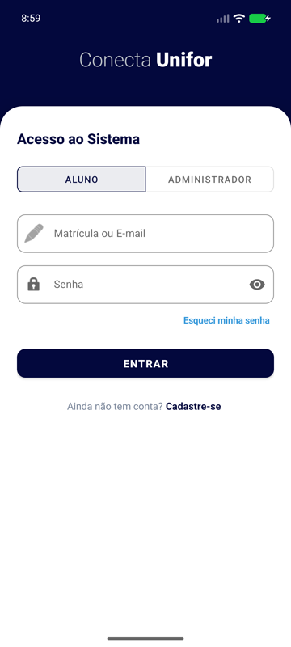
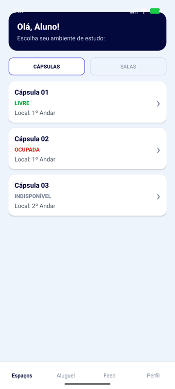
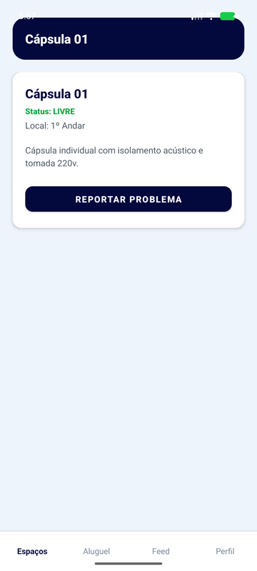
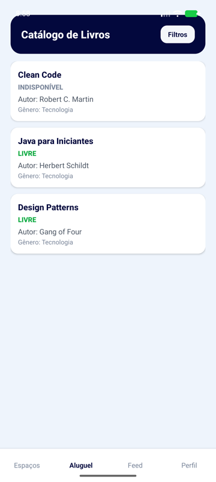

# 📚 Conecta Unifor — app Android

Aplicativo **Android nativo em Kotlin** para a comunidade acadêmica da UNIFOR: **reserva de espaços de estudo** (cápsulas e salas), **catálogo e aluguel de livros**, **feed de postagens** entre alunos e um **painel de administração**.

Projeto em grupo da disciplina de **Desenvolvimento de Plataformas Móveis** (Ciência da Computação — UNIFOR).

---

## ✨ Funcionalidades

**Aluno**
- Cadastro e login (perfil **Aluno** ou **Administrador**)
- **Espaços**: cápsulas individuais e salas, com status *livre / ocupada / indisponível* e opção de **reportar problema**
- **Catálogo de livros** com filtros, detalhe do livro e aluguel
- **Feed**: criar, editar e ver postagens
- **Perfil** com abas de posts, salvos, desejados e alugados

**Administrador**
- Gestão do **acervo**, **categorias** e **espaços** (formulários de cadastro e edição)
- Controle de **aluguéis**
- **Moderação** de postagens e tratamento de **reportes** de problemas

| Login | Espaços | Detalhe | Catálogo |
|---|---|---|---|
|  |  |  |  |

## 🛠️ Tecnologias

**Kotlin** · **Android SDK** (minSdk 24, targetSdk 36) · Views/XML com **Material 3** · **Firebase Firestore** · Gradle (Kotlin DSL)

## 🧱 Organização

- **23 telas** (`Activity`), separadas entre fluxo do aluno e do administrador
- **Componentes de UI reutilizáveis**: barra de navegação inferior por perfil (`NavigationHelper`), diálogos padrão de confirmação e informação (`DialogHelper`) e estilos, cores e *drawables* centralizados em `res/values`
- **Sessão** do usuário logado em `SessionManager`
- **Dados**: cadastro, login e postagens no **Firestore**; espaços, livros e aluguéis ainda usam **dados de exemplo em memória** (`MockData`)

## ▶️ Como rodar

1. Abra a pasta no **Android Studio**.
2. Crie um projeto no [Firebase](https://console.firebase.google.com/), adicione um app Android com o pacote `com.example.conectaunifor` e coloque o arquivo **`google-services.json`** em `app/` *(ele não está no repositório por conter as chaves do projeto)*.
3. Rode em um emulador ou celular com Android 7.0+.

## 🚧 Próximos passos

- Migrar espaços, livros e aluguéis dos dados de exemplo para o Firestore
- Usar o **Firebase Authentication** no login e no cadastro, em vez de guardar a senha na coleção de usuários
- Regras de segurança do Firestore por perfil (aluno / administrador)

## 👥 Equipe

Projeto desenvolvido em grupo por **Alef**, **Caio**, **Dimitri Gomes de Albuquerque** e **João Marcelo**. O trabalho foi dividido de forma que **todos participaram de todas as partes** do app (telas, navegação e integração com o Firebase), que depois foram unidas na versão final.

## 🤝 Como foi desenvolvido

Na reta final, o grupo usou o **Claude Code** (IA da Anthropic) para reorganizar o projeto: padronizar telas, cores e componentes reutilizáveis (navegação, diálogos e estilos).

---

👤 **Dimitri Gomes de Albuquerque** · [GitHub](https://github.com/Dimitri7) · [LinkedIn](https://www.linkedin.com/in/dimitri-albuquerque-66b32b278/)
